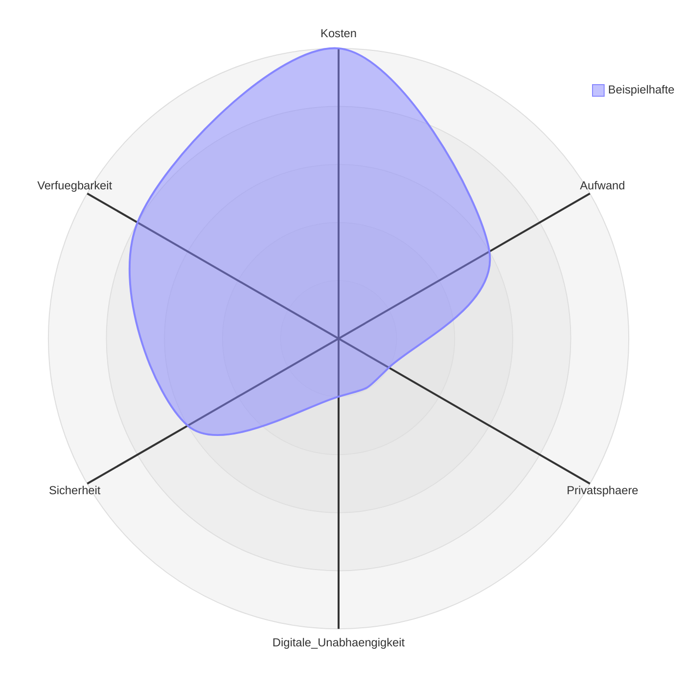

# Digitale Unabhängigkeit in der Familie

Daten gehören uns oft nicht nur uns allein.

---
layout: section
---

# Motivation

Was ist Digitale Unanhängigkeit?

<!-- 
Bevor wir loslegen
Was ist digitale Unabhängigkeit?
Der Begriff wird auch im Rahmen der Abhängigkeit der EU von der USA verwendet
Oder der Abhängigkeit der städtischer IT von Microsoft

Im Rahmen dieser Veranstaltung reden mehr über digitale Unabhängigkeit im privaten Umfeld

Wenn wir auf der Diday Seite gucken, da gibt es ein umfangreiches FAQ
aber wenn ich persönlich das mit meinen Worten zusammenfassen soll:

selbstbestimmtest und unabhängiges digitales Leben zu führen. 

Und da gibt es Hindernisse

Es passt nicht gut in das Geschäftsmodell von Google und Microsoft 
Aber eventuell harmonieren staatliche Interessen nicht mit meinen Bedürfniss nach Privatsphäre.

Bei den meisten Vorträgen standen bisher einzelne Person und die Daten des Einzelnen im Fokus.

Aber, Daten gehören oft nicht nur uns allein.
Und die digitae Dienste nutzen wir oft in Kooperation mit anderen Personen

Und eine Institution, in der besonders viele persönliche Daten ausgetauscht und gemeinsam genutzt werden ist die Familie.

Wenn das kein Grund ist, sich das Thema genauer anzugucken
-->

---

# Die Familie als Zielgruppe

* Gemeinsame Daten und Dienste fördern langfristige Bindung
* Kinder wachsen in ein Ökosystem hinein
* Starker Lockin Effekt
* Anbieter verkaufen Familiengruppen zusätzliche Abos und Dienste
* Verknüpfte Familiendaten sind für Werbezwecke interessant

<Admonition  title="Familien Dienste " color="teal-light" width="500px" >
Google One, Youtube Kids, Microsoft 365 Family, Spotify Family, Steam Family, Apple Family Sharing, Komoot Family
</Admonition>

<!-- 
Frage an das Publikum: Wer hat eine Email-Addresse für seine Kinder angelegt?

Interessante Zielgruppe

Starker Lockin Effekt: Es ist schwieriger als Familie das Ökosystem zu wechseln 
Viele Produkte, die auf Familien zugeschnitten sind: 
Viele sind kostenlos, aber oft gibt es auch Zusatzdienste, die man bezahlen muss.
Um fair zu bleiben, auch kleinere Firmen machen das. Mailbox, Proton, Tuta

Viele von den kleinen 

-->

---

# Die digitalen Daten einer Familie

* Bilder, Filme, Spiele und Dokumente
* Accounts, Passwörter und Zugangsdaten
* Kalenderdaten
* Kontakte
* Chat-Nachrichten

<!-- 
Von welchen Daten und Diensten reden wir?
-->

---

# Gemeinsam genutzte Dienste 

* Cloudspeicher ( z.B. für Fotos, Dokumente )
* E-Mail-Provider
* Messenger
* Streaming- und SpeielDienste
* Internet-Provider
* Passwort-Manager

<!-- 
Die konkrete Ausprägung ist sehr unterschiedlich
Vieles Punkte kommen uns aber uns bekannt vor: 
-->

---
layout: side-title
---

# Wer ist Teil der Familien-IT?

Familien-IT ist vielfälltig

* Familie: Ehepartner und Kinder
* Eigene Eltern und Verwandte
* Freunde und Bekannte

<!-- 

Familie kann auch die WG sein,

So unterschiedlich wie eine Familien IT aussehen kann, so kann man auch den Begriff Familie sehr weit fassen:
Von Eltern mit Kinder bis zu einer StundenWG
 -->

---

# Zielkonflikte in der Familien-IT

<!-- 
Digitale Unabhängigkeit ist nur eins von vielen Zielen, die bestimmt wie die Famlien IT aussieht
Auch die Liste ist nicht vollständig
Das ist kein Familien Ding
-->
---
layout: two-cols-header
---
::left::

# Allgemeine Zielkonflikte
* Ziele stehen im Konflikt
* Bin ich bereit, für digitale Unabhängigkeit Geld auszugeben, und wenn ja, wie viel?
* Wie viel Aufwand und Energie bin ich bereit zu investieren?
* Alles in ein Ökosystem? Oder lieber aufteilen?

<!-- 
Digitale Unabhängigkeit nur eine von vielen und Zielen und Prioritäten
Manche Ziele ergeben sich aus äußeren Zwängen: Geld ist so einer
Reddit diskussion: Manchmal gibt es zu den Zielvorstellungen keine Lösung
-->

::right::

# Zusätzliche Hürden in Familien
* Wie setzt man als Familie Prioritäten?
* Konsensfindung in der Familie
* Unterschiedliche Prioritäten in der Familie
* Unterschiedliches Wissen in der Familie

<!-- 
Ähnlich wie bei Einzelpersonen, aber es gibt zusätzliche Hürden und Probleme für Familien
Man ist allein und braucht einen Konsens
Es kann sein, dass ich Windows-Admin in der zentralen IT meiner Firma bin, mein Sohn ist CCC in Darmstadt und beiteiligt sich am DiDay
Das ist ein überspitztes Beispiel, ich hoffe es verdeutlich aber die Punkte Konsensfindunf und Prioritäten in der Familie

-->

---
layout: section
---

# Konkretes Probleme

<!-- 

Wir haben viel über Familien-IT geredet, wir reden jetzt über ein ernstes Problem

-->

---

# Das Problem mit der Familienadministration
Wenn eine Person ausfällt …

* Nur eine Person kennt die Familien-IT
* Zugänge und Zuständigkeiten sind unklar
* Wichtige Daten und Dienste werden unerreichbar
* Krankheit, Tod, Trennung oder Urlaub können reichen

Eine Person darf kein Single Point of Failure sein.

<!-- 
Bisher haben wir immer von Tech Riesen geredet und wie sie untere Digitale Souveränität untergraben.

Aber egal wie die konkrete Familien IT aussieht ( US Cloud Dienste und der FamilienServer im Keller), es bleibt das Problem des Familien Adminstrators

Wie Familie kann man den Begriff sehr weit fassen

Zur Veranschaulichung folgendes Szenario: Ein Nerd managed die IT der Familie: eigener DNS Server, Firewall, Familien Domäne die beim Mail-Provider liegt, FileServer usw

Und dann passiert irgendwas: Krankheit oder Safari in Afrika 
Und gleichzeitig:  Zertifikat laeuft ab, der Passwortsafe liegen auf eine quantensicher verschlüsselten USB Stick und plötzlich geht das Internet nicht mehr

Es muss nicht der männliche IT-Nerd sein, der sich selbst verwirklicht: Auch Kinder die die IT der Eltern managen: Jung meine Fritz.box blinkt und das Wlan geht nicht mehr
Es muss auch nicht eine Person sein
Verschiedene Formen und Ausprägungen

Notfälle und ungünstige Verkettungen sind Vielfälltig: Tod, Scheidung, Hardwaredefekte und Urlaub

Digitale Abhängigkeit von einer Person ist ein Problem für die digitale Unabhängigkeit
-->
---

# Dokumentation der Familien-IT

Wir sollten uns über Dokumentation unterhalten!

* Geräte, Dienste und Daten erfassen
* Accounts und Wiederherstellungsoptionen dokumentieren
* Backups und Speicherorte dokumentieren
* Zuständigkeiten dokumentieren
* Kenntnisstand der Familie berücksichtigen
* Dokumentation gemeinsam überprüfen
* Wiederherstellung üben

 Die IT-Dokumentation gehört in den Notfallordner.

<!--
 Eine Lösung: Dokumentation
 Hätte ich meiner Mutter das Passwort und die URL auf einen gelben Zettel geschrieben, würde das meinem Bruder wahrscheinlich helfen
 Mag keiner, viele verdrängen das
 Inhalt kann varieren
 Notfalls kann man die Dokumentation einem Experten geben

 Wenn man schon dabei ist, man kann direkt anfangen noch andere Sachen zu dokumentieren: Bankdaten, Versicherung usw
 Teil des Notfallordners

Hat jemand einen Notfallordner?
-->

---

# Wie dokumentiert man die Familien-IT?

* Niedrigschwellig beginnen: Papier, PDF,  USB-Stick 
* Backup-Best-Practices beachten: Mehrere Kopien an verschiedenen Ort aufbewahren
* Sicherheit und Zugriffsschutz beachten
* Dokumentation regelmäßig aktualisieren
* Zuständigkeiten und Änderungen festhalten

 Die beste Dokumentation ist eine, die im Notfall gefunden und verstanden werden kann.

<!-- 
Ok, die Doku sollte gefunden und verstanden werden und bei Notfällen helfen
Es gibt Backup-Best Practices, die sollte man beachten: Verteile Kopiene
Teilweise muss Passwörter dokumentieren, die dürfen auf keinen Fall in fremde Hände gegraten,
Eventuell auf: Verschlüsselung, Passwortsafe
Online-Services
-->

---

# Konkrete Beispiele

---

# Notfälle in der Familien-IT

## Auslöser:
* Krankheit und Tod
* Urlaub oder längere Abwesenheit

## Folgen
* Zugänge und Daten sind nicht erreichbar
* Niemand kennt Passwörter und Zuständigkeiten

## Was hilft?
* Dokumentation für mehrere Personen
* Vertretungs und Recoveryoptionen nutzen
* Wiederherstellung regelmäßig testen

<!--

Wir haben jetzt dokumentiert: Ist denn damit die Digitale Unabhängigkeit gerettet?

Wir schauen uns mal ein paar Beispielnotfälle an

Die Auflistung ist nicht vollständig
Und manchmal kommt ein Problem nicht allein: Vielleicht ist jemand nicht erreichbar, aber solange das Internet geht ist das nicht schlimm

Beispiele haben wir eben schon aufgezählt:
Das Internet geht nicht, aber keiner weiß das Passwort der Fritzbox, weil der Familien Administrator in Urlaub ist.
Es ist unklar, welche blinkende Kästchen im Keller dafür zustandig ist.
Kein Zugriff oder Verlust von Dokumenten und Photos weil man auf die Accounts nicht mehr zugreifen kann.
Passwörter für verschlüsselte Dokumente fehlen.

Dokumentation würde hier helfen, aber die Qualität der Dokumentation ist wichtig
Gleichzeitig bieten manche Cloud-Dienstleister für solche Fälle Vertretungs und Recovery-Optionen an. Die sollte man in der Dokumenation erwähnen und nutzen

Aber: Dokumentation hilft nicht bei allen Notfällen und reicht alleine nicht, das sehen wir an den nächsten Beispielen
-->

---

# Verlust von Accounts
* Vergessene Zugangsdaten
* Account gesperrt oder übernommen

## Folgen
* Kein Zugriff auf Fotos, Dokumente und Nachrichten

## Vorbeugen
* Wichtige Daten unabhängig sichern
* Recovery-Optionen überprüfen

<!--

Account-Verlust kann jeden treffen, man muss nicht beim internationalen Strafgerichtshof arbeiten
Und man sollte vorsorgen und vorbeugen, damit nicht das ganze digitale Leben der Familie weg ist.

Betrifft eventuell die ganze Familie

Hier hilft Dokumentation nicht mehr

-->

---

# Trennung und Ausscheiden aus der Familien-IT

Eine Person muss die Familien-IT verlassen können, ohne sie lahmzulegen oder Daten anderer mitzunehmen.

## Besondere Vorkehrungen
* Zugriffsrechte
* Getrennte Konten
* Datenzuordnung
* Schutz vor Sabotage

<!-- 
Verlassen der Familien-IT: Es muss nicht die Scheidung, manchmal verlassen die Kinder den Haushalt

Vielleicht möchten meine Kinder einmal ihre Fotos und Dokumente mitnehmen
Und ich muss mir Gedanken machen, ob sie mir noch gehören

Bei Trennung kommen noch Problem der Sabotage dazu
Passwörter werden geändert, Dokumente gelöscht usw

-->

---

# Weitere wichtige Fragen 

* Sicherheit und Zugriffsberechtigungen
* Privatsphäre in der Familie
* Kinder auf dem Weg in die Selbstständigkeit
* Backups und Recovery
* FamilienIT ohne US Riesen
* Praktische Umsetzung
* Digitaler Nachlass

<!-- 
30 Minuten sind nicht viel für so ein umfangreiches Thema
Wit treffen uns seit fast einem Jahr und uns gehen die Themen nichts aus
Ich habe das Thema: Familienadministrator und dokumentation fand ich am wichtigsten
-->
---

# Fazit

## Erste Schritte

* Familien-IT dokumentieren und Inventar erstellen
* Dabei Prioritäten setzen
* Recovery- und Vertretungsoptionen einrichten
* Zuständigkeiten klären 
* Backups einrichten und Wiederherstellung testen

<!-- 

Erste Schritte unabhängig wie die Famlien IT aussieht,
Die kann man immer noch umbauen, erstmal geht es um den Ist-Zustand
-->

---

Die Folien findet ihr hier: 

<QRCode value="https://github.com/hnaussed/digitale-unabhaengigkeit-in-der-familie" :size="200" render-as="svg" />

<!--
Fragen?

-->

---

# Quellen und weiterführende Informationen
* https://www.my-it-brain.de/wordpress/dokumentation-fuer-den-notfall-bzw-das-digitale-erbe/
* https://www.my-it-brain.de/wordpress/nerds-gefaehrden-die-digitale-souveraenitaet-ihrer-familie/

